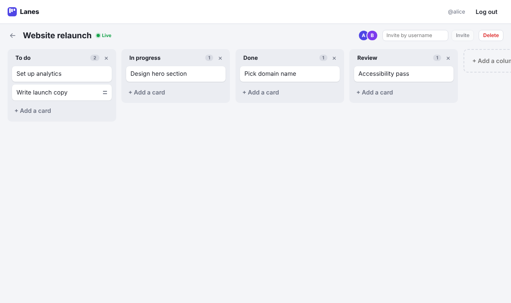
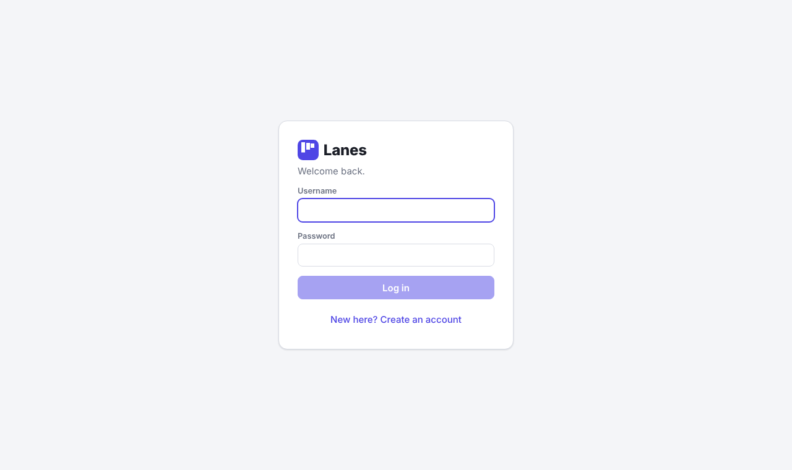
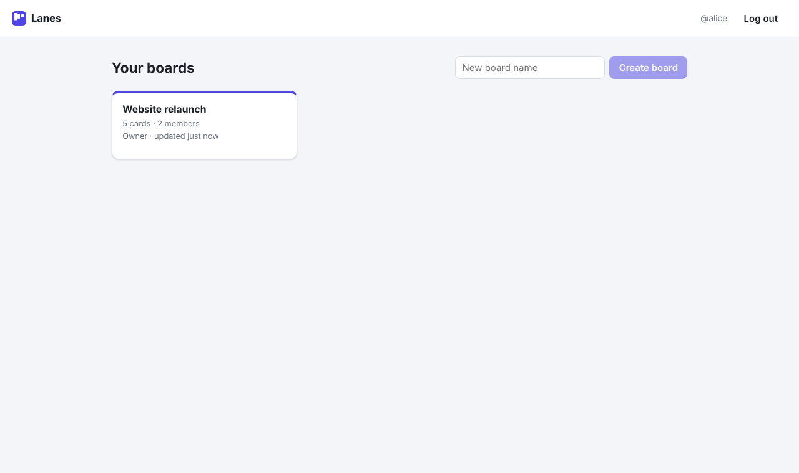
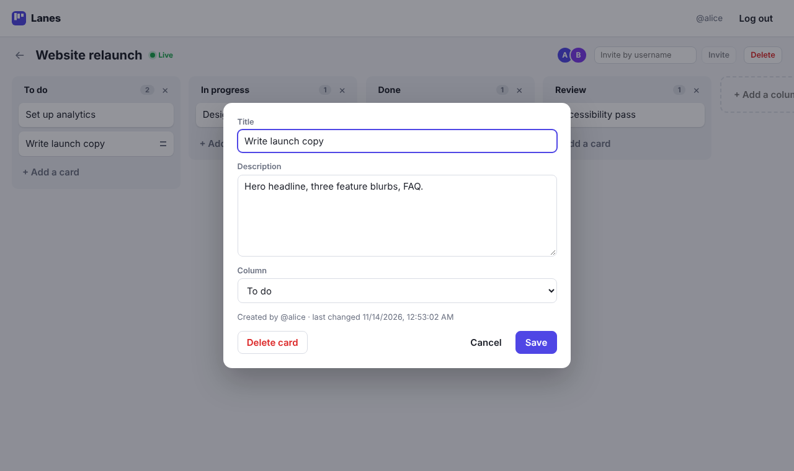

# Lanes

[](https://github.com/jeremiahpetion03/lanes/actions/workflows/ci.yml)

A real-time collaborative Kanban board. Create a board, invite teammates, and drag cards between columns. Everyone watching the board sees each change instantly.

**Stack:** React 19 + TypeScript front-end · Node.js API · SQLite database · Server-Sent Events for live updates



## Features

- **Accounts:** sign up, log in, and log out, with secure password hashing and session cookies
- **Boards:** create, rename, and delete boards, and invite other users by username
- **Columns and cards:** add, rename, and delete columns; create, edit, and delete cards with titles and descriptions
- **Drag and drop:** move cards within and between columns. A "Column" picker in the card dialog does the same thing for keyboard users.
- **Real-time collaboration:** changes appear immediately for everyone on the board, with no refresh
- **Optimistic UI:** your own changes show up instantly. If the server rejects one, the board re-syncs and tells you why.
- **Permissions:** owners and members. Only owners can invite people or delete the board.

| Log in | Your boards | Edit a card |
|---|---|---|
|  |  |  |

## Running it

Requires **Node.js 22.13 or newer** (it uses Node's built-in SQLite).

```bash
npm install
npm run build      # bundle the React app into dist/
npm start          # http://localhost:3000
```

Open two different browsers, or one normal window and one private window, sign up as two users, and invite one to the other's board to watch changes sync live.

| Command | What it does |
|---|---|
| `npm run dev` | Rebuild the front-end and restart the server on every change |
| `npm test` | 21 API and unit tests |
| `npm run test:e2e` | Browser tests with two real Chromium users (run `npx playwright install chromium` once first) |
| `npm run typecheck` | TypeScript check of the whole project |

Every push runs all of these on GitHub Actions (see the badge above), plus a Docker build and container check.

### With Docker

```bash
docker build -t lanes .
docker run -p 3000:3000 -v lanes-data:/data lanes    # http://localhost:3000
```

The image is built in two stages, so the final image contains only the server, the built front-end, and production dependencies. It runs as a non-root user and keeps the SQLite database on a volume (`/data`), so your data survives container restarts. CI builds the image and checks that the running container serves both the app and the API.

Settings come from environment variables: `PORT` (default 3000), `DATABASE_PATH` (default `lanes.db`), and `COOKIE_SECURE=1` when serving over HTTPS.

## How it's built

```
Browser (React)                              Server (Node.js)
───────────────                              ────────────────
 BoardView ── drag/edit ──► api.ts ── fetch ──► router ─► auth check ─► routes.ts ─► SQLite
     ▲                                                                       │
     │                                                                       │ publish
 useBoard ◄──── EventSource (SSE) ◄─────────── EventHub ◄────────────────────┘
 (applies events to state)                     (one stream per open board tab)
```

```
shared/      TypeScript types for every request/response, used by BOTH sides
server/      app.ts (request pipeline) · routes.ts (endpoints) · auth.ts · db.ts · events.ts
web/src/     App.tsx · components/ · useBoard.ts (sync logic) · boardState.ts (pure state updates)
tests/       API + unit tests (node:test)
e2e/         Two-browser Playwright tests
```

The back-end deliberately uses no web framework. Routing, body parsing, cookies, and static file serving are written directly on Node's `http` module, so every layer of the request is visible in the code.

## Design decisions

These are the parts worth understanding, and the questions an interviewer is most likely to ask.

**1. One source of truth for the API contract.** Request and response types live in `shared/api.ts` and are imported by both the server and the React client. If a response shape changes and one side isn't updated, the project stops compiling.

**2. Authorization in the query, not after it.** Every lookup of a board, column, or card joins against `board_members` for the current user. Someone who isn't a member gets a **404, not a 403**, so they can't even confirm a board with that id exists. The tests try every endpoint as an outsider.

**3. Passwords and sessions:**
- Passwords are hashed with **scrypt** (slow on purpose) with a random salt per user. Comparison is constant-time.
- A failed login takes the same time and returns the same message whether or not the username exists, so it can't be used to discover accounts.
- The session cookie is **HttpOnly** (page scripts can't read it, so an XSS bug can't steal it) and **SameSite=Lax**. The database stores only a **SHA-256 of the token**, so a leaked database can't be used to log in.
- Repeated failed logins for an account are **rate limited** (10 per 15 minutes).

**4. CSRF protection.** Every state-changing request must send an `x-lanes-csrf` header. A malicious site can make your browser *send* a request, but browsers won't let it add custom headers to a cross-site request without the server's approval, which this server never gives.

**5. Card ordering with fractional positions.** Each card has a decimal `position`, and a column's order is "sort by position." Moving a card between positions 1024 and 2048 gives it 1536, so only **one row changes** instead of renumbering every card below it. Repeated halving eventually runs out of floating-point precision; when that happens the server renumbers the column. A test performs 80 inserts into the same spot to prove it stays correct. The same function runs on the client for optimistic moves, so the card lands where the server will put it.

**6. Real-time sync without losing updates.** The client opens the event stream *first*, then fetches the board. Events that arrive while that fetch is in flight are queued and replayed on top of the snapshot. Without that queue, a change made in the gap between "load" and "subscribe" would silently disappear. Every event carries the full updated object, so applying the same event twice is harmless.

**7. Why Server-Sent Events instead of WebSockets.** Updates only need to flow server → browser; edits already go through normal API requests. SSE is plain HTTP, reconnects automatically, and works through proxies. WebSockets would add a second protocol for no benefit here.

**8. Optimistic updates with rollback.** Moves, edits, and deletes update the screen before the server responds. If the request fails, the client shows the error and re-fetches the board. Creates wait for the server instead, because a temporary client-side id could end up duplicated alongside the real one.

**9. Defense in depth:** request bodies capped at 64 KB, JSON-only, validated field by field with errors that name the field; a Content-Security-Policy header; path-traversal protection on static files; database migrations versioned with `PRAGMA user_version`; foreign keys with `ON DELETE CASCADE` so deleting a board removes everything under it.

## API

All endpoints are JSON under `/api`. Every one except auth requires a session.

| Method | Path | Purpose |
|---|---|---|
| POST | `/auth/register` · `/auth/login` · `/auth/logout` | Accounts and sessions |
| GET | `/auth/me` | Current user |
| GET, POST | `/boards` | List / create boards |
| GET, PATCH, DELETE | `/boards/:id` | Read / rename / delete (owner) |
| POST | `/boards/:id/members` | Invite a user (owner) |
| GET | `/boards/:id/events` | Live event stream (SSE) |
| POST | `/boards/:id/columns` | Add a column |
| PATCH, DELETE | `/columns/:id` | Rename / delete a column |
| POST | `/columns/:id/cards` | Add a card |
| PATCH, DELETE | `/cards/:id` | Edit / delete a card |
| POST | `/cards/:id/move` | Move a card: `{ columnId, index }` |

## Testing

- **API tests** (`tests/api.test.ts`): run against a real HTTP server with an in-memory database. They cover the auth flows, rate limiting, CSRF, outsiders being locked out of every endpoint, owner/member permissions, ordering under stress, and live event delivery.
- **Unit tests** (`tests/boardState.test.ts`): the client's pure state functions, including that they never mutate previous state (React depends on this).
- **End-to-end** (`e2e/board.test.ts`): two separate Chromium users sign up, share a board, drag cards, and edit in real time, checking that each sees the other's changes without reloading.

## What I'd add next

- Column reordering by drag (the fractional-position logic already supports it)
- Removing members and leaving a board
- Horizontal scaling: SSE fan-out is in-process, so running several servers would need a shared pub/sub such as Redis or Postgres `LISTEN/NOTIFY`
- Postgres instead of SQLite for multi-server deployments

## License

MIT
